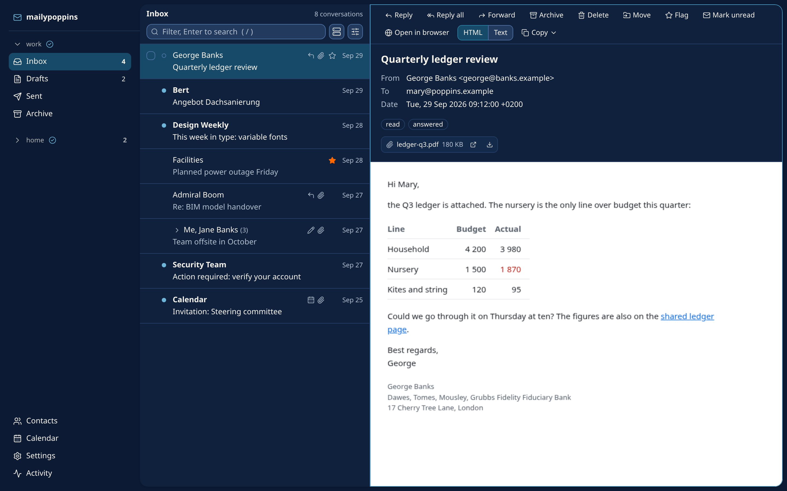

# mailypoppins

I created mailypoppins for two reasons.

First, I wanted to read and edit my emails in Neovim, like I edit everything else.
I live in the terminal, none of the mainstream email clients let me do that, and the global Vim layers on the Mac all fall short.

Second, I wanted my AI agents to help me with email: tell me which messages I still have to answer, and check my drafts for typos, missing points and language before I send them.
I wanted to work on a draft together with the agent, without copying my text over to it and its corrections back, and to see the difference between my version and its version.
None of this worked with Copilot or the AI extensions of existing email clients.

So I built it myself.
In mailypoppins every draft is a Markdown file: I write it in Neovim, my agent edits the same file, and a diff shows what it changed.



## How it works

mailypoppins is a daemon with three clients.
The daemon owns the accounts, syncs mail into a local store and runs the send queue.
The clients talk to it over a Unix socket and offer the same operations:

- the `mp` command line, for scripts and AI agents;
- the terminal UI, which `mp` opens when run without arguments;
- the desktop app for macOS.

A change made in one client shows up in the others at once.

## Features

- IMAP and SMTP accounts, and Microsoft 365 through OAuth2 or the Graph API.
- Drafts as Markdown files with YAML frontmatter, opened in your `$EDITOR`; the desktop app runs Neovim inside its window.
- An approval step before sending, an undo-send window and a durable outbox.
- Conversations that gather a thread from Inbox, Sent, Archive and Drafts.
- One search syntax for the server and the local store.
- Calendar invitations: send them, answer them and see them in an agenda.
- A contacts index built from your mail, signatures as Markdown files, and hooks that run a command on matching incoming mail.
- Vim keys, a which-key popup and a command palette in the terminal UI and the desktop app.

## Getting started

Install the command line and the terminal UI with Homebrew, on macOS or Linux:

```sh
brew install sylvainHellin/mailypoppins/mailypoppins
```

The full name taps the repository and trusts only this formula, which Homebrew 6 requires for any third-party tap.

The desktop app is a DMG for Apple silicon on the [releases page](https://github.com/sylvainHellin/mailypoppins/releases); it carries its own `mp`.
The app is not signed yet, so macOS blocks its first launch: the [getting started guide](https://mailypoppins.com/getting-started/#mac-app) shows how to allow it and how to use the app's `mp` from a terminal.
To build the command line and the terminal UI from source, run `cargo install --path .` in a clone; [clients/desktop/README.md](clients/desktop/README.md) covers the app.

Then add an account and open the terminal UI:

```sh
mp config init
mp
```

## Documentation

- [mailypoppins.com](https://mailypoppins.com) covers [getting started](https://mailypoppins.com/getting-started/), the [commands](https://mailypoppins.com/commands/), the [configuration](https://mailypoppins.com/config/), the [draft format](https://mailypoppins.com/draft-format/) and an [FAQ](https://mailypoppins.com/faq/).
- `mp --help` lists every command, and `?` in the terminal UI every key.
- [docs/](docs/) holds the architecture, the daemon protocol, the secrets model and the release process.
- [clients/desktop/README.md](clients/desktop/README.md) covers the desktop app's build.

## Contributing

See [CONTRIBUTING.md](CONTRIBUTING.md).

## License

[MIT](LICENSE)
